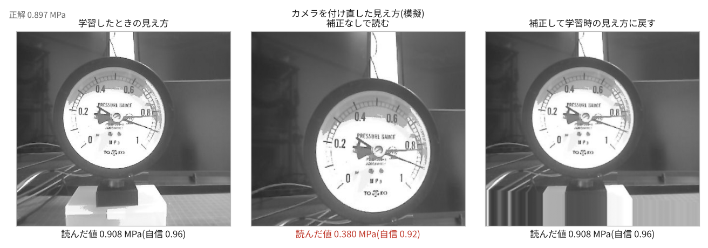
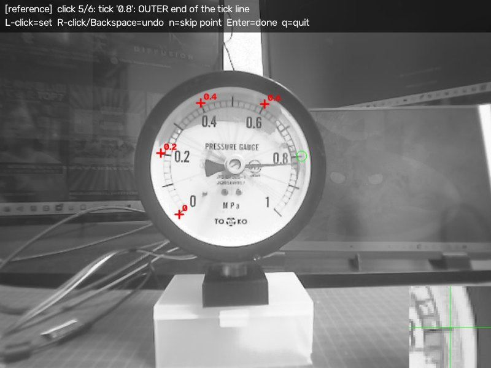
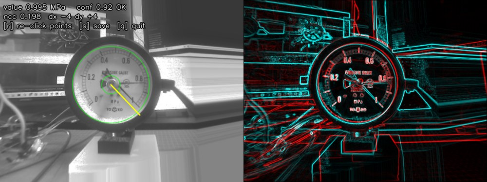
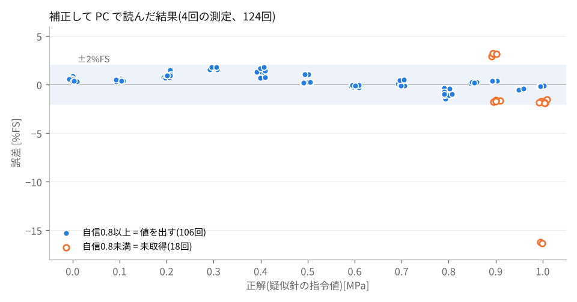
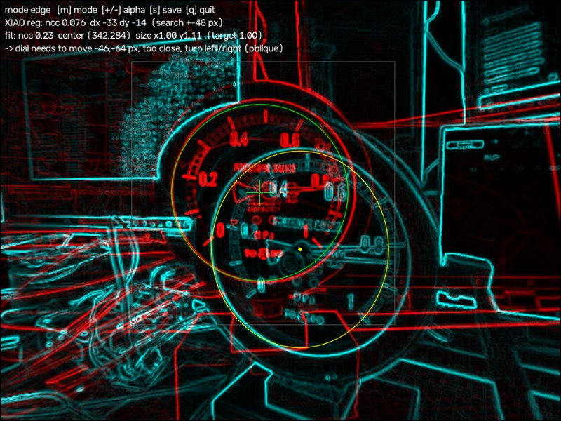
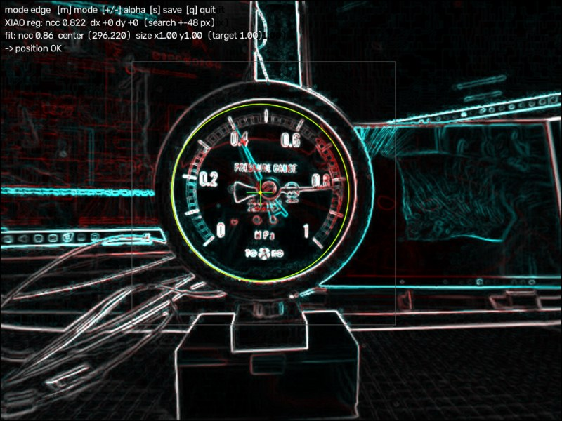

# カメラ位置の補正(アラインメント)ガイド

XIAO の機械学習版(極座標CNN)は、**学習したときのカメラ位置で写った画像**しか正しく読めません。
カメラやブラケットを付け直したら、このガイドの手順で補正してください。集め直しや学習のやり直しは要りません。

- 補正の考え方と手順 … このページ
- 全コードの一覧 … [GUIDE.md](GUIDE.md)
- 経緯と測定の詳細 … [DEVLOG.md](DEVLOG.md)(2026-11-25)

## なぜ補正が必要か

XIAO は読む前に、今の画像を学習時の基準画像と比べて、上下左右のずれ(±48画素まで)を直します。
直せるのは平行移動だけです。カメラが近づいた・遠ざかった・斜めになった、という変化は直せません。

下の図は、学習データの画像を「付け直したカメラ」の見え方に変形して試したものです
(1.2倍に大きく、右下にずらし、左右に斜め)。



- 真ん中: 補正なしでは 0.897MPa を **0.380MPa と読み、しかも自信 0.92**(XIAO の基準 0.8 を超える)。値が出てしまうので、気づけない誤読になります
- 右: 今の画像を学習時の見え方に変換(射影変換)してから読むと、0.908MPa(自信 0.96)に戻ります

## 方法は2つ

| 方法 | 内容 | 向き不向き |
|---|---|---|
| **A. 補正する(推奨)** | 今の画像と基準画像で同じ目印(目盛り線の先)をクリックし、射影変換を求めて XIAO に送る。XIAO は毎回、画像を学習時の見え方に変換してから読む | カメラを付け直すたびに数分で済む |
| B. 元の位置に戻す | ライブ画像に基準画像を重ねて表示し、カメラを動かして合わせる | 位置・距離・向き・傾きの6つが連動するので、手で合わせるのはかなり難しい。確認用 |

## A. 補正する(hom_check.py)

### 準備
- XIAO のファームが補正に対応していること(2026-11-25 以降の main.cpp。`http://<XIAOのIP>/hom` を開いて JSON が返れば対応済み)
- PC に `pip install torch numpy opencv-python pillow requests`
- コマンドは `05_ml` フォルダで実行。XIAO の IP が違うときは `--xiao` を書き換える

### 1. カメラを固定する
ブラケットをしっかり固定します。この後でカメラが動いたら、手順 3 からやり直しです。
文字盤全体が写り、目盛り線がはっきり見えることを確認してください(`.\run_check.bat` で1枚撮れます)。

### 2. 基準画像で目盛りの点をクリックする(初回だけ)
```
.\run_hom_check.bat
```
学習時の基準画像が開きます。次の 6 点を、この順番でクリックします。

**0、0.2、0.4、0.6、0.8、1.0 の各数字の横にある目盛り線の、外側の端**



- 画面の上に、次にクリックする点が出ます。右下の拡大鏡(カーソルの周りを4倍)で端を正確に合わせます
- 右クリックか Backspace で1つ戻す。影などで見えない点は `n` で飛ばす(4点以上あれば計算できます)
- 6点そろったら Enter。点は `models\hom_ref_pts.json` に保存され、次からは聞かれません
- **針の軸はクリックしません。** 軸のキャップは文字盤から浮いているので、斜めから見ると文字盤の面からずれて見え、変換が歪みます
  (実測で、軸を入れると自信 0.69、目盛り6点だけだと 0.80〜0.91)

### 3. 今の画像で同じ点をクリックする
続けて XIAO のライブ画像が開きます。基準画像と **同じ順番・同じ場所** をクリックして Enter。
点は `results\hom_live_pts.json` に保存されます。

PowerShell に各点のずれが出ます。

```
変換に使った点: 0 0.6px, 0.2 0.7px, 0.4 0.4px, 0.6 0.2px, 0.8 0.6px, 1.0 0.6px / 平均のずれ 0.5 画素(3 以下が目安。大きい点はクリックし直す)
```
平均が 3 画素を超えるとき、または1点だけ大きいときは、その点のクリックがずれています。画面で `r` を押してクリックし直します。

### 4. 読み取り画面で確かめる
クリックが終わると、PC が XIAO と同じ計算で読み続けます。



| 見る所 | 合っているときの様子 |
|---|---|
| 左の画像 | 学習時と同じ大きさ・正面の見え方に変換されている。緑の輪が文字盤の目盛りの内側に来る |
| 右の輪郭(赤=基準、シアン=今の画像) | 目盛り・数字・外枠の赤とシアンがほぼ重なる(背景はずれていてよい) |
| value | 針の位置と合っている |
| conf(自信) | 0.8 以上なら XIAO は値を出す。0.9 以上あれば余裕がある |
| ncc dx dy | dx、dy が数画素以内。ncc は背景や照明の違いで 0.2 前後でも問題ない |

`s` で画面を `results\hom_日時.png` に保存、`q` で終了します。

### 5. 疑似圧力計で測る(任意)
疑似圧力計があれば、針を動かしながら誤差を測れます。XIAO に送る前の確認に使います。
```
python hom_check.py --xiao http://192.168.11.5 --needle COM8 --per 3
```
0〜1.0MPa を 0.1 刻みで3回ずつ読み、最後に誤差と「自信0.8以上の割合」を出します。結果は `results\hom_measure_日時.csv`。
`--targets 1.0,0.9,0.8` のように値と順番を変えられます。

作者の環境(ブラケット変更後、左右に約20°斜め)で4回測った結果:



- 0〜0.85MPa: すべて自信 0.8 以上。値を出した回の誤差は平均 0.65%FS、最大 1.82%FS
- 0.9〜1.0MPa: 測った時によって自信が 0.4〜0.8 に下がり、XIAO では「未取得」になる(誤読としては出ない)。課題として残っています(下の「わかっている制限」)
- 誤差には疑似針(28BYJ-48)のガタが含まれます。上下どちらから近づけたかで 0.2〜0.9%FS 違います

### 6. XIAO に送る
```
python hom_check.py --xiao http://192.168.11.5 --upload
```
`200 {"on":true,"m":[...]}` と出れば設定済みです。XIAO 内に保存され、再起動しても残ります。

ブラウザで `http://192.168.11.5/nn?n=3` を開いて確認します。

```
{"ok":true, ... "value":0.9949, ... "conf_min":0.835,"cf":0.80, ... "hom":1, ... "ms":7102, ...}
```
- `"hom":1` … 補正が効いている
- `"ok":true` と value … 読めている
- `ms` … 3枚で約7秒かかる(補正の変換が加わるため)。トレンドなどの定期読み取りは 10 秒以上の間隔にする

### カメラをまた動かしたとき
```
python hom_check.py --xiao http://192.168.11.5 --redo
python hom_check.py --xiao http://192.168.11.5 --upload
```
基準画像の点はそのまま使い、今の画像だけクリックし直します。補正をやめるときは `--clear` です。

## B. 元の位置に戻す(align_view.py)

学習したときの位置にカメラを戻したいとき、または補正の前に大きなずれを確認したいときに使います。
```
.\run_align.bat
```
XIAO のライブ画像(シアン)に、学習時の基準画像(赤)の輪郭を重ねて、約1秒ごとに更新します。

| ずれている(ブラケット変更直後) | 合っている(学習時の位置) |
|---|---|
|  |  |

| 表示 | 意味 |
|---|---|
| 緑の十字と円 | 学習時の針の軸と文字盤の位置 |
| 黄の円・楕円 | 今の文字盤の推定位置と大きさ |
| `XIAO reg: ncc dx dy` | XIAO と同じ位置合わせの結果。ncc が 0.5 以上で dx、dy が ±10 画素以内なら読める |
| `fit: center size x/y` | 広く照合した推定。size は基準に対する倍率で、1 より大きいと近すぎ、x と y が違うと斜め |
| `->` | 次に直す向き。`position OK` になれば合っている |

キー: `m` 表示の切り替え、`+` `-` 半透明の濃さ、`s` 保存、`q` 終了。

ずれが大きいうち(ncc が 0.2 以下)は fit の推定も不安定です。まず赤とシアンの外枠をおおまかに重ねてから、数値で詰めます。
実際には、6つの自由度(上下・左右・前後の位置、左右・上下の向き、回転)を手で同時に合わせるのは難しく、作者は A に切り替えました。

## うまくいかないとき

| 症状 | 原因と対処 |
|---|---|
| PowerShell で `run_hom_check.bat` が見つからない | 先頭に `.\` を付ける(`.\run_hom_check.bat`) |
| 測定で疑似針が動かない | クリック画面が後ろに隠れていないか確認(クリックが終わるまで針は動かない)。ほかに COM8 を使うもの(run_wander.bat、シリアルモニター)を閉じる |
| conf が全体に低い(0.7 前後) | クリックのずれ。手順 3 のずれの表示を確認し、`r` でクリックし直す。針の軸はクリックしない |
| 右の輪郭が重ならない | 点の順番を間違えている。基準と同じ順番(0 → 1.0)でクリックし直す |
| `--upload` で 404 | XIAO のファームが古い。02_xiao_reader を書き込み直す |
| XIAO の `/nn` が PC と違う | `/hom` の `on` が true か確認。`--clear` を実行すると補正は止まる(行列は残る) |
| 0.9〜1.0MPa だけ未取得 | わかっている制限(下)。照明を変えると改善することがある |

## わかっている制限

- 補正で戻せるのは文字盤の形(大きさ・位置・斜め)だけです。照明・影・映り込みの違いと、文字盤から浮いている針の視差は残ります
- 作者の環境では、左右に約20°斜めにしたとき 0.9〜1.0MPa で自信が下がりました。置針(0.8付近の細い針)と針・文字盤の見かけの位置関係が、斜めでは学習時と変わることが候補です。
  改善するには、今の位置で 300 位置ほど集め直し、補正後の画像で追加学習する方法があります(未実施)
- 補正中の XIAO は1回の読み取り(3枚)に約7秒かかります
- 読めるのは学習した文字盤だけです。別の計器には集め直しと学習が必要です

## 関係するファイル

| ファイル | 内容 |
|---|---|
| `05_ml/hom_check.py`、`run_hom_check.bat` | クリック、PC での読み取り・測定、XIAO への送信(`--upload` `--clear` `--redo` `--needle`) |
| `05_ml/align_view.py`、`run_align.bat` | 基準画像との重ね合わせ表示 |
| `05_ml/models/hom_ref_pts.json` | 基準画像でクリックした点 |
| `05_ml/results/hom_live_pts.json` | 今の画像でクリックした点と、求めた変換 |
| `02_xiao_reader/include/nn_polar.h` の `polarWarp` | XIAO 側の変換(OpenCV の warpPerspective と同じ結果。画素値の差は最大1) |
| `02_xiao_reader/src/main.cpp` の `/hom` | 変換の設定・解除・保存(NVS の "homm") |
