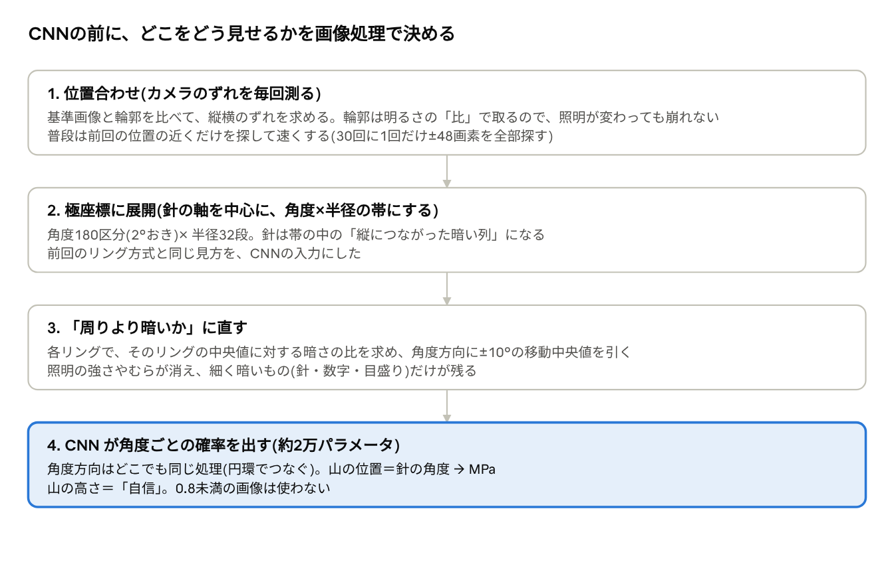
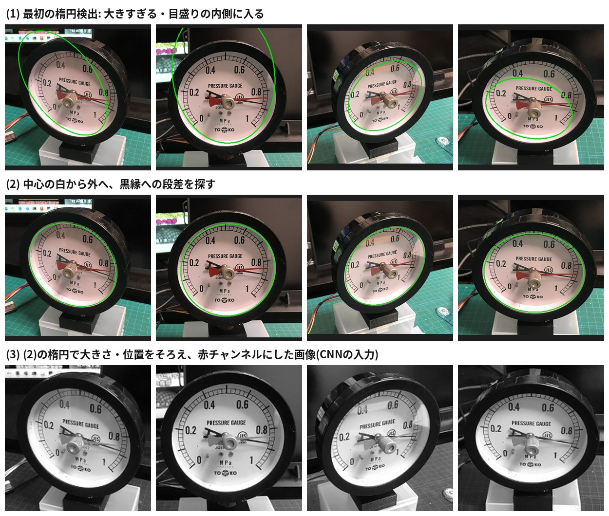
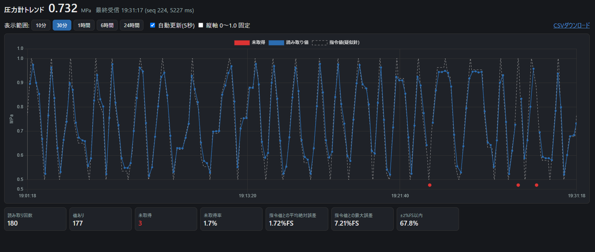
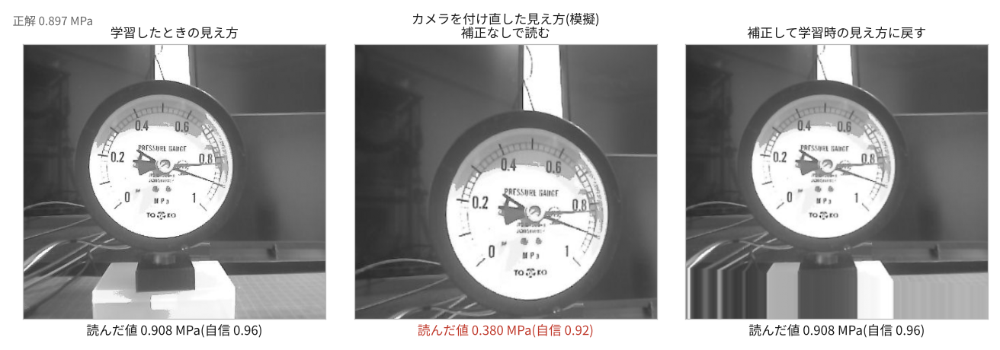
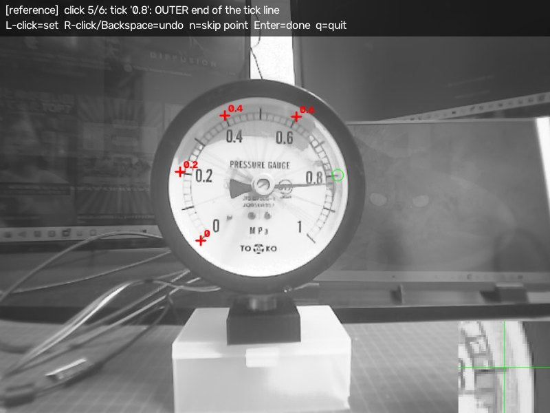
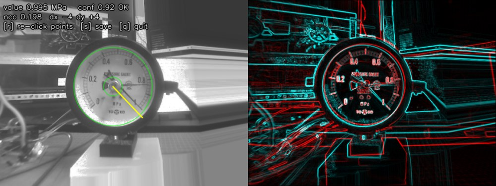
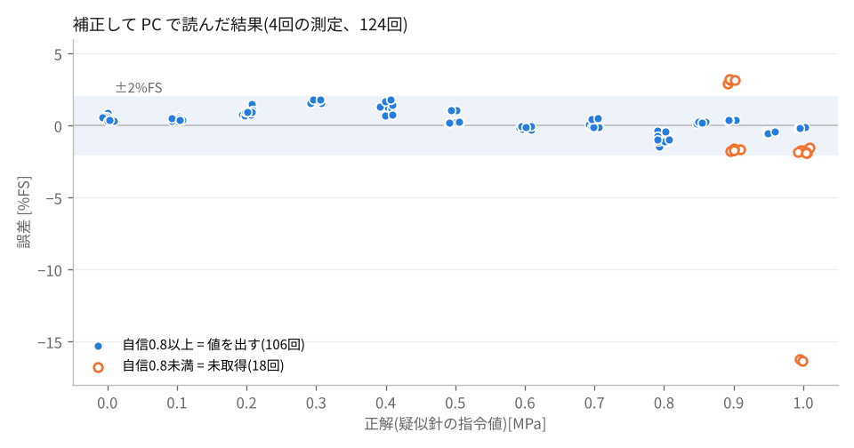

# ESP32カメラでアナログ圧力計を読む(2) 機械学習編

Nov 21, 2026

## はじめに

機械学習で針を読ませ、XIAO ESP32S3 Sense の実機で正面100点(50回中50回正解、平均誤差0.26%FS)になりました。前回の画像処理と同じ精度です。そこまでに、データの集め方と、CNNに渡す前の画像の切り出し方を何度かやり直しています。

前回は、計器の縁に黒丸のマーカーを4つ貼り、画像を正面に直してから「細いリング20本で針を探す」画像処理で読みました。正面でも約42°の斜めでも、誤読0・平均誤差0.3〜0.5%FSでした。

今回は同じ XIAO で、機械学習(小さなCNN)で針を読ませます。この記事の範囲は次のとおりです。

1. 疑似圧力計で、正解付きの学習データを自動で集める
2. 最初のCNNがうまくいかなかった理由
3. 目盛板を正確に切り出す工夫(位置合わせと極座標展開)
4. 画像を人工的に斜めにして学習させ、斜めにも強くする
5. スマホ写真で、画像処理だけの方法と比べる
6. Flask のトレンドグラフで動かしてみる
7. 自分で試す手順
8. カメラを付け直したときの位置の補正(アラインメント)

## 学習データを自動で集める

機械学習には「画像と正しい値」の組が大量に要ります。疑似圧力計(実物の文字盤にステッピングモーターの針)を使い、正解付きの画像を人手なしで集めました。

1. PCから Arduino UNO に「0〜1.0MPaの乱数の位置へ」と指示し、針を動かす(最後の寄せは常に同じ向きで、ギアのガタをそろえる)
2. XIAO に640×480の白黒画像を撮らせる
3. 画像と、UNOが返した針の位置(正解)をCSVに記録する

1位置は約3〜5秒です。後の実験で使ったデータは次のとおりです。

| セット | 照明 | 枚数 | 所要 |
| --- | --- | --- | --- |
| front | 朝の天井照明 | 2000 | 約2.7時間 |
| dark | 照明を消し、モニターと窓の明かりだけ | 500 | 約25分 |
| desk | デスクライトを斜めから(映り込み・針の影) | 510 | 約25分 |
| window | 窓からの日差し＋天井照明 | 500 | 約25分 |

疑似針はギアのガタと原点復帰のばらつきで、1%FS程度ずれます。正解の値そのものにこの程度の誤差があることに、後で気づきました。

学習は PC(CPU)で PyTorch を使い、1回数分〜20分です。学習した重みをCのヘッダーに書き出し、XIAO のファームに組み込みます。推論はCで自前実装し、PCでPyTorchと同じ値が出ることを確かめてから書き込んでいます。

## 最初のCNNは、学習した条件でしか読めなかった

最初は、文字盤のまわりを決まった位置で切り抜き(256×256→64×64)、小さなCNNで値を直接出させました。PCのテストでは平均0.49%FSでしたが、実機に載せると崩れました。

| 版 | 変えたこと | 実機の結果(50点) | 分かったこと |
| --- | --- | --- | --- |
| v1 | 最初の形 | 正解23・誤読15(46点) | 学習時と露出が違う。切り抜きの四隅に背景のモニターが入り、それに反応していた |
| v2 | 円の外を使わない、明るさの水増し | 正解49・誤読1(98点) | 学習した照明なら読める |
| v3 | 照明3種を混ぜて学習 | 正解0・誤読14(0点) | 他の原因だと思っていたが、実はカメラが30画素ずれていた(後述) |
| v5 | 3モデルの意見が割れたら読まない | 正解29・誤読0(58点) | 誤読は止まるが、未取得が多い |

v1〜v5 の実機テストで分かったこと:

- **学習していない照明では読めない。** 暗い部屋のデータを外して学習すると、暗い部屋での平均誤差は18%FSになりました。
- **知らない条件でも、自信ありげに間違う。** 画像処理のような「読めないときは読まない」判断を、別に用意する必要があります。
- **決まった位置で切り抜く方式は、もろい。** 書き込みのUSBを挿したときに、カメラが横に約30画素ずれていました。画像の位置を比べて初めて気づき、v3の0点の主な原因はこれでした。

## 目盛板を正確に切り出す: 位置合わせと極座標展開

写真をそのままCNNに渡すのをやめ、文字盤の位置合わせと切り出しを画像処理で済ませてから渡すようにしました。これで実機の正面が100点(平均0.26%FS)になり、カメラが30画素ずれていても読めるようになりました。



位置合わせには、照明が変わっても形が変わりにくい輪郭(明るさの比で取った輪郭)を使いました。針の捉え方は前回のリング方式と同じで、中心から外周まで続く暗い線を探します。そのリングを並べた帯画像を、そのままCNNの入力にしています。

なお、CNN は目盛りの「0」や「1.0」の数字も、目盛り線も読んでいません。CNN が出すのは針の角度(2°刻みで180区分のどこに針があるか)だけです。角度を圧力に直すのは、0 MPa のときの針の角度(132.49°)と、0〜1.0 MPa で針が回る角度(275.32°)の2つの定数です。この2つは、疑似圧力計に指示した値と写った針の角度の関係から求めました。学習の正解も、画像を見て付けたものではなく、UNO に指示した値そのものです。斜め用・スマホ用のモデルは角度を経由せず値を直接出しますが、「この文字盤で針がこの向きならこの値」という対応を覚えている点は同じです。

| テスト | 結果 |
| --- | --- |
| 実機 正面・天井照明(50点) | 100点、平均0.26%FS、最大1.30%FS |
| 実機 正面・デスクライト(50点) | 100点、平均0.30%FS、最大1.58%FS |
| PC 学習していない回の画像(日差し・天井・暗い部屋・デスクライト 各50枚) | ±2%FS以内 94・100・98・84% |
| 1回の読み取り(3枚) | 約5.2秒(1枚約1.0秒) |

速さは、位置合わせを「前回の位置の近くだけ探す」形にして、1枚3.2秒から1.0秒に縮めました。

写真の中の計器の大きさが毎回違う場合(スマホなど)は、基準画像との比較が使えません。その場合は、黒い縁の内側の境目を中心から放射状に探し、その楕円の中心と長径で大きさと位置をそろえます。詳しくは後の「スマホ写真で比べる」に書きます。

## 画像を人工的に斜めにして学習する

正面の画像だけで学習したモデルは、斜めから撮ると読めません。そこで、正面の画像4,000枚を「文字盤を斜めから見た形」に人工的に変形させて学習させました。新しい撮影はしていません。

変形は、文字盤の面を0〜35°傾けた射影変換(傾く向きは乱数)です。回転(±8°)・拡大縮小(±15%)・平行移動・明るさ・映り込み・ぼけも乱数で加えます。正解の値は元の画像のまま使えるので、何枚でも作れます。

この変形を画像ファイルとして書き出すスクリプトも、リポジトリに置きました(`05_ml/augment_dataset.py`)。元の画像1枚から指定した枚数の変形画像と、正解の値を書いた `labels.csv` を作ります。学習スクリプト(`train_persp.py`)は同じ変形を学習中に自動でかけるので、こちらは他の学習ツールで使うときや、どんな画像になるかを見たいとき用です。

XIAOを実際に15°・30°斜めに置いて撮った画像(各 50枚、学習には使っていない)で比べました。

| 角度 | 極座標CNN(正面だけで学習、実機) | 斜めに変形して学習(PC) |
| --- | --- | --- |
| 15° | 80点、平均1.15%FS | ±2%FS以内 92%、平均0.95%FS |
| 30° | 12点、最大39%FSの誤読 | ±2%FS以内 94%、平均0.82%FS |

30°でも、±2%FSを超えたのは2.1〜2.8%FSで、大きく外したものはありませんでした。30°で12点だったのは、学習データに斜めの画像が1枚もなかったためで、撮り直さなくても変形で作った画像で補えました。

ただし弱点も残りました。

- 強い逆光の暗い画像では、±2%FS以内が70%に落ちました。極座標CNN(98%)より悪く、自信が高いまま大きく外す例もありました。
- 30°で約1%FSの誤差が残るのは、針が文字盤より手前にあるための視差を、平面の変形では再現できないためだと考えています。
- このモデル(約40万パラメータ)はまだ PC での検証だけで、XIAO には載せていません。

## スマホ写真で比べる: 画像処理だけでは読めなかった写真

マーカーなしでスマホ写真から読む画像処理を、別に N100 の PC 向けに書いていました。針を 0.87MPa で止めた別の計器(TOKO 0〜1.0MPa)を iPhone で8枚撮り、それで試しています。

結果は8枚とも「読めない」判定でした。参考に出した値も −0.15〜0.87MPa とばらばらです。つまずいたのは、目盛板の縁と、針の2か所でした。

**目盛板の縁が取れない。** 最初の楕円検出は、背景や縁の影まで含んだ大きすぎる楕円になったり、目盛りの円弧に引っかかって内側に小さく入ったりしました(下の図の(1))。この計器には、楕円に見えるものがいくつも重なっています。外側のケースの縁、黒縁の内側(文字盤との境目)、目盛りの線が並ぶ円弧、黒縁が文字盤に落とす影です。しかも目盛りの円弧は約270°で途中が切れています。輪郭に楕円を当てはめる方法では、どれに合うかが写真しだいになります。

**針が取れない。** 縁が取れても、針を直線として探すと、「PRESSURE GAUGE」の文字、軸のギザギザ(ローレット)、赤い置針まで線として拾います。暗さの閾値を固定していたので、写真が明るいと針が線として残らないこともありました。斜めから撮ると、文字盤より手前にある針の軸と、縁の楕円の中心もずれます。

縁は、探し方を変えたら取れるようになりました。

1. 文字盤の中心付近で、いちばん白い部分の重心から出発する
2. そこから2°おきに180方向へ、外向きに明るさを調べ、「明るい → 急に暗い」段差を探す
3. 段差の先が15画素ほど続けて暗いことを条件にする。目盛りの線や文字は細く、すぐ明るさが戻るので条件を満たさない。続けて暗いのは黒縁だけ
4. 隣の方向(前後5方向)と比べて半径が飛んでいる点は捨て、残りの点に楕円を当てはめる

これで8枚とも、黒縁の内側に沿った楕円になりました(図の(2))。

針は、画像処理で直すのをやめて CNN に任せました。(2)の楕円の中心と長径を使い、写真ごとに計器の大きさと位置をそろえた画像(192×192、縁の外に余白35%)を作って渡します(図の(3))。カラー写真は赤チャンネルだけを使うので、赤い置針は白に近くなり、ほとんど見えなくなります。CNN は XIAO の画像に加え、疑似圧力計の前で iPhone の姿勢を5通り変えて撮った約1,000枚を、斜め変形付きで学習させたものです。



| 方法 | 8枚の結果 |
| --- | --- |
| 画像処理だけ(縁の楕円 → 針を直線で探す) | 8枚とも未取得。参考値 −0.15〜0.87 |
| 斜め変形で学習したモデル。縁でそろえず、余白を付けて縮小しただけ | ±2%FS以内 3枚。強い斜めの2枚は 0.29 と 0.23 |
| 縁でそろえ、iPhone の画像も加えて学習 | 8枚とも ±2%FS以内(0.856〜0.881) |

3段目では、縁でそろえる処理と iPhone の学習データを同時に加えたので、どちらがどれだけ効いたかは分けて確かめていません。画像処理で全部を決めようとすると、縁・針・軸のどれか1つを外しただけで読めなくなります。画像処理は縁を探して大きさをそろえるところまでにして、針の読み取りは学習に任せた分け方が、この8枚ではうまくいきました。

## Flask のトレンドグラフで動かす

画像処理版と同じ仕組みで、XIAO が定期的に機械学習で読んだ値を PC の Flask サーバーへ送り、ブラウザでトレンドグラフにします。疑似針は 0.5〜1.0MPa をランダムな速さで往復させ、指令値も同じグラフに重ねます。

- XIAO 側: 定期読み取りを機械学習(極座標CNN)に切り替える設定(`/log/set?nn=1`)。自信が低いときは「未取得」として送る
- サーバー側: 画像処理版とデータが混ざらないよう、保存先を分けた(`gauge_nn.db`)
- 読み取り間隔: 10秒(1回の読み取りに約5秒かかるため、画像処理版の5秒より長くした)

最初に動かしたときは、41回中27回(66%)が未取得でした。値が出たのは、針が折り返す頂上と谷、止まっている区間だけです。記録を指令値と突き合わせると、原因は読み取りの間に針が動いていることでした。1回の読み取りは3枚で約5秒かかり、その間に疑似針は0.05〜0.14MPa動きます。一方、3枚の値の幅が0.03MPaを超えたら未取得にする判定にしていたので、針が動いている間はほぼ必ず捨てられていました。1枚ずつの自信は高く、読めてはいたのです。

そこで、判定を次のように変えました。幅が0.03MPaを超えても、撮った順に値が同じ向きへ少しずつ(1枚ごとに0.15MPa以下)変わっていれば「針が動いている」とみなし、最後の1枚の値を出します。向きがばらばらなときや、急に大きく飛んだときは、これまでどおり未取得です。

変更後の30分間の結果です(疑似針は0.5〜1.0MPaを約25秒で片道、ときどき止まる)。



| 項目 | 変更前(10分間) | 変更後(30分間) |
| --- | --- | --- |
| 読み取り回数 | 41 | 180 |
| 未取得率 | 65.9% | 1.7% |
| 指令値との平均絶対誤差 | 1.76%FS | 1.72%FS |
| ±2%FS以内 | 69.2% | 67.8% |
| 最大誤差 | 5.44%FS | 7.21%FS |

未取得はほぼなくなりました。誤差の数字が大きめなのは、動いている針を、受信した時刻の指令値と比べているためです。最後の1枚を撮ってから送信までに時間があり、その間に針は進みます。記録から計算すると、比べる指令値を2秒前にずらすと、平均誤差は約1.1%FS、±2%FS以内は約87%になります。針が止まっていた回(19回)だけでは、平均0.89%FS、最大1.89%FSで、すべて±2%FS以内でした。

実際の圧力計がこの疑似針ほど速く動くことは少ないので、定期的に値を記録する用途ならこれで十分だと考えています。速く動く針を追うには、1回の読み取りを1枚(約1.7秒)にする方法を次に試す予定です。

## 自分で試す手順

コードは GitHub に置いています(https://github.com/whiskerpad/Xiao\_gauge-reader)。機械学習の部分は `05_ml` フォルダです。Windows の PC を前提に、コマンドは `05_ml` フォルダで開いたコマンドプロンプトに打ちます(エクスプローラーのアドレス欄に `cmd` と打って Enter)。

### 準備

1. Python 3.10 以上を入れる(python.org。インストール時に「Add python.exe to PATH」にチェック)
2. 必要なライブラリを入れる: `pip install numpy opencv-python pillow torch pyserial requests flask`(torch は CPU 版で十分)
3. XIAO ESP32S3 Sense に `02_xiao_reader` を書き込む(VS Code + PlatformIO。Wi-Fi の設定は `include\secrets.h.example` を `secrets.h` にコピーして書く)
4. `.bat` の中の `COM8`(UNO のポート)と `192.168.11.5`(XIAO の IP)を自分の環境に合わせて書き換える

### 疑似圧力計がない場合: 写真を読ませてみる

いちばん手軽なのはこれです。学習済みのモデルが入っているので、計器を中央に大きく撮った写真を用意して次を打ちます。

```
python read_phone.py 写真のフォルダ
```

写真ごとに値と「自信」が出ます。自信が0.8未満なら「未取得」です。ただしこのモデルは、0〜1.0MPa・白い文字盤・黒い縁の計器で学習したものです。目盛りの角度や範囲が違う計器は、そのままでは正しく読めません。

### 疑似圧力計がある場合: 集めて、学習して、XIAO に載せる

1. `run_check.bat` を実行し、`data\check.jpg` で計器全体が写っているか確認する
2. `run_collect.bat` で2000位置を集める(2〜3時間)。照明を変えたセットは `run_collect_dark.bat` などで別に集める
3. カメラ位置や計器が私の環境と違う場合は、1枚の画像をペイントで開き、針の軸・0目盛りの先・最大目盛りの先の画素位置を読んで `python calib_angles.py --pivot 296,220 --zero 214,309 --full 384,307` のように渡す。出てきた CX, CY を `polar.py` に、A0, SPAN を `train_polar.py` に書き換える
4. `run_train_polar.bat data\集めたフォルダ` を実行する。学習用データの作成(`make_npz.py`)、学習(`train_polar.py`)、XIAO 用のヘッダー書き出し(`export_polar.py`)まで続けて動きます。CPU で数分〜十数分です。元のヘッダーは `nn_polar_data.h.bak` に残ります
5. VS Code で `02_xiao_reader` をビルドして XIAO に書き込む
6. `run_eval_nn.bat` で、新しい乱数位置50点の採点をする(結果は `results` フォルダ)
7. `04_pi_server\run_server_nn.bat` と `01_stepper_needle\run_wander.bat` を起動し、ブラウザで http://127.0.0.1:5000 を開くとトレンドグラフが出る

### 学習データの集め方(詳しく)

機械学習の精度は、「画像と正しい値」の組をどれだけ正確に、どれだけ多く集められるかで決まります。私は疑似圧力計で針を自動で動かし、人手なしで集めました。

**1. 疑似圧力計を用意する**

- 実物の圧力計の文字盤と針を使い、針の軸をステッピングモーター(28BYJ-48)で回す。私は針を 3D プリントのカップリングで軸に固定しました
- モータードライバー ULN2003 を Arduino UNO の D8〜D11 につなぐ(IN1〜IN4)
- 針が 0 より少し手前で当たるストッパーを付ける。原点復帰では針をここに押し当てる

**2. UNO にスケッチを書き込み、目盛りに合わせる**

1. `01_stepper_needle\needle_stepper\needle_stepper.ino` を Arduino IDE で開き、振れ角(`SCALE_DEG`、普通の圧力計は 270)と最大目盛り(`SCALE_MAX_MPA`)を自分の計器に合わせて書き込む。針が逆に回るときは `INVERT_DIR` を切り替える
2. `python needle_test.py COM8 calib` で、針を少しずつ動かして 0 目盛りと最大目盛りに合わせる。表示された値をスケッチの `ZERO_OFFSET_STEPS` と `fullSteps` に書き込んで、もう一度書き込む
3. `python needle_test.py COM8 sweep` で、0→1.0→0 と 0.1 刻みで動かし、針が目盛りと合うか目で確かめる

COM 番号は、Windows のデバイスマネージャーの「ポート」で確かめます(私の環境では UNO が COM8、XIAO が COM5)。

**3. カメラを固定して構図を決める**

1. XIAO を計器の正面に固定する。収集を始めたら、カメラも計器も動かさない
2. `05_ml\run_check.bat` を実行し、`05_ml\data\check.jpg` を開いて計器全体が写り、ピントが合っているか確かめる

**4. 自動で集める**

`05_ml\run_collect.bat` を実行すると、次を 2000 回繰り返します(私の環境で約 2.7 時間)。

1. PC が UNO に「0〜1.0MPa の乱数の位置へ」と指示する。最後はいつも同じ向きから寄せて、ギアのガタをそろえる
2. XIAO から 640×480 の白黒画像を受け取る(XIAO の `/capture.jpg`)
3. 画像と、UNO が返した針の位置(正解)を記録する。300 回ごとに原点復帰して、位置のずれがたまらないようにする

中のコマンドは次のとおりです。

```
python collect.py --port COM8 --xiao http://192.168.11.5 --count 2000 --tag front_ceiling
```

| オプション | 内容 |
| --- | --- |
| --count | 集める位置の数 |
| --tag | 保存フォルダ名に付くメモ(照明の条件など) |
| --edge 0.2 | 2割を 0 と最大目盛りの付近から選ぶ(端を多めに学習させる) |
| --rehome 300 | 何回ごとに原点復帰するか |
| --frames 2 | 1つの位置で撮る枚数 |
| --out data\フォルダ | 途中で止まったとき、そのフォルダに追記して再開する |

結果は `05_ml\data\日時_タグ\` に、画像(`images\`)と正解の一覧(`labels.csv`)ができます。`labels.csv` の `file` 列が画像の場所、`mpa` 列が正解の値です。

**5. 照明を変えて足す**

同じ照明でだけ集めると、ちがう照明では読めません(前半の v1〜v5 の話)。私は次の3種類を 500 回ずつ足しました(それぞれ約 25 分)。

- `run_collect_dark.bat`: 部屋の照明を消し、モニターと窓の明かりだけ
- `run_collect_desklight.bat`: デスクライトを斜めから当てる(映り込みと針の影)
- `run_collect_window.bat`: 窓からの日差しと天井照明

**集めるときの注意**

- 収集の途中でカメラや計器が動くと、その後の画像は別の構図になります。私は USB を挿した拍子にカメラが約 30 画素ずれ、しばらく気づきませんでした。動いたら `--tag` を変えて別のセットにします
- 正解は UNO への指令値です。ギアのガタと原点復帰のばらつきで、実際の針とは 1%FS 程度ずれます
- 収集中は、XIAO の定期読み取りは自動で止まります

**iPhone で集める場合**

前に作った iphone\_capture(iPhone を PC から撮影できるツール)を使います。

1. `iphone_capture\start.bat` を起動し、iPhone で撮影ページを開いて「カメラを開始」。iPhone は給電し、自動ロックを「なし」にする
2. `05_ml\run_check_iphone.bat` で構図を確かめる
3. `05_ml\run_collect_iphone.bat` を実行する。200 回ごとに止まるので、iPhone の位置や角度を変えて、メモ(例: 斜め右45°)を入れて Enter。XIAO も同じ瞬間に撮ります

**疑似圧力計がない場合**

針が止まった計器をいろいろな角度や明るさで撮り、目で読んだ値を `labels.csv` に書けば、同じ形のデータになります。列は `file`(画像の場所)と `mpa`(値)の2つで足ります。

```
file,mpa
images/IMG_0001.jpg,0.35
images/IMG_0002.jpg,0.35
images/IMG_0003.jpg,0.62
```

数を稼ぐには、針の位置を変えて(圧力が変わるときに)撮り、下の「学習データを増やす」で斜めの画像を作ります。ただし、人が目で読んだ値にはそれ自体に誤差があるので、疑似圧力計ほどの精度は期待できません。針の位置も何種類もは撮れないので、学習用の枚数をそろえるのは大変です。

### 学習データを増やす

```
python augment_dataset.py data\集めたフォルダ data\増やした先 --count 5
```

元の画像1枚から5枚、斜め・回転・明るさを変えた画像を作ります。傾きの最大は `--tilt`(既定35°)、文字盤の中心は `--center x,y` で指定します。細かいオプションは `05_ml\README.md` にまとめました。

## カメラを付け直したとき: 位置の補正(アラインメント)

XIAO を固定するブラケットを作り替えたら、機械学習版がまったく読めなくなりました。`/nn` の位置合わせの一致度は 0.04 で、ほぼ一致していません。写り方を学習時と比べると、文字盤が右へ約55・下へ約70画素ずれ、約1.2倍に大きく写り、左右に約20°斜めになっていました。XIAO の位置合わせが直せるのは上下左右のずれ(±48画素まで)だけで、大きさと斜めは直せません。

困るのは、読めないだけでなく、自信ありげに間違うことです。学習データの画像を同じように変形して試すと、0.897MPa を 0.380MPa、自信 0.92 と読みました(下の図の真ん中)。XIAO は自信 0.8 以上なら値を出すので、この誤読はそのまま記録されます。



最初は、XIAO のライブ画像に学習時の基準画像を重ねて表示するツール(`align_view.py`)を作り、カメラを元の位置に戻そうとしました。しかし、上下・左右・前後の位置と、左右・上下の向き、回転の6つが連動するので、1つを合わせると別のものがずれます。手では合わせきれませんでした。

そこで、カメラを戻すのをやめ、画像のほうを学習時の見え方に戻すことにしました。文字盤は平面なので、文字盤の上の4点以上の対応が分かれば、射影変換で「学習時と同じ大きさ・同じ向き」の画像に直せます。対応する点は手でクリックします。

1. 学習時の基準画像で、0・0.2・0.4・0.6・0.8・1.0 の目盛り線の外側の端を順にクリックする(初回だけ)
2. 今の XIAO の画像で、同じ6点を同じ順にクリックする
3. PC が射影変換を求め、変換した画像を XIAO と同じ計算で読んで確かめる
4. 変換の行列(9個の数)を XIAO に送る。XIAO は以後、読むたびに画像を変換してから、位置合わせと CNN に渡す



画像の特徴点を自動で対応づける方法(SIFT)も試しましたが、照明とひさしの影の違いで一致する点が7点しか取れず、使えませんでした。クリックは6点で1分ほどです。

つまずいたのは針の軸です。最初は軸の中心もクリックする点に入れていましたが、自信が 0.69 までしか上がりませんでした。軸のキャップは文字盤より手前に浮いているので、斜めから見ると文字盤の面からずれた位置に見えます。目盛り6点だけにすると、各点のずれは1画素以下になり、XIAO 実機の自信は 0.80〜0.91 に上がりました。



補正したまま、疑似圧力計を 0〜1.0MPa で動かして PC で測りました(4回、計124回の読み取り)。0〜0.85MPa はすべて自信 0.8 以上で、値を出した回の誤差は平均 0.65%FS、最大 1.82%FS でした。XIAO 実機でも、1.0MPa を 0.994・0.995 と読めています。



残った課題もあります。

- 0.9〜1.0MPa は、測ったときによって自信が 0.4〜0.8 に下がり、未取得になります(誤読としては出ません)。斜めから見ると、0.8 付近の置針と針・文字盤の見かけの位置関係が学習時と変わるためだと考えています。今の位置で数百位置を集め直して追加学習すれば改善する見込みですが、まだ試していません
- 補正で直せるのは文字盤の形だけです。照明・影の違いと、文字盤から浮いている針の視差は残ります
- 変換の分だけ遅くなり、1回の読み取り(3枚)に約7秒かかります
- 誤差には疑似針のガタが混ざっています。上下どちらから近づけたかで 0.2〜0.9%FS 違いました

機械学習版を自分の環境で使うとき、いちばん手間がかかったのは、学習したときとカメラの位置がずれることでした。収集のあとでカメラを動かしてしまったら、集め直す前にこの補正を試してください。手順はリポジトリの `docs/ALIGNMENT.md` に画像付きでまとめ、全部のコードの用途は `docs/GUIDE.md` に一覧にしました。使うコマンドは次の3つです(`05_ml` フォルダで実行)。

```
python hom_check.py --xiao http://192.168.11.5
python hom_check.py --xiao http://192.168.11.5 --needle COM8 --per 3
python hom_check.py --xiao http://192.168.11.5 --upload
```

1行目はクリックして PC で読み取りを確かめる、2行目は疑似圧力計で誤差を測る、3行目は XIAO に変換を送るコマンドです。カメラをまた動かしたら、`--redo` を付けて今の画像の6点だけクリックし直し、もう一度 `--upload` します。

## 画像処理と機械学習の比較と、次回

正面の精度は同じくらいになりました。違うのは得意な条件と、使い始めるまでの準備です。

| 項目 | 画像処理(マーカー＋リング方式) | 機械学習(極座標CNN) |
| --- | --- | --- |
| 正面の精度(実機) | 96点、平均0.26%FS | 100点、平均0.26%FS |
| 約42°の斜め | 96点(マーカーで正面化＋視差補正) | 30°で±2%FS以内 94%(斜め変形で学習した別モデル、PC) |
| マーカー | 必要(紙リング) | 不要 |
| 赤い置針との重なり | 未取得になる | 読める |
| 知らない照明 | 判定で止まる | 学習データが要る(極座標の前処理でかなり強くなった) |
| 準備 | 中心を設定、目盛りをクリック | 疑似圧力計で数千枚を収集して学習 |
| 範囲や文字盤が違う計器 | 中心と目盛りの設定をやり直す | その計器の画像で学習し直す(文字盤ごとに学習が必要) |
| カメラを付け直したとき | マーカーで毎回自動で正面に直す | 目盛り6点をクリックして射影変換で補正(1分ほど) |
| 1回の読み取り | 約3秒 | 約5秒 |

結果を左右したのは、モデルの大きさではなく、CNNに渡す前の処理でした。文字盤の位置をそろえ、針のまわりを極座標で切り出してから渡すと、数千枚のデータでも照明やカメラのずれに強くなりました。撮っていない角度も、正面の画像を変形して学習させるだけで読めるようになりました。

ただし、機械学習版は**文字盤ごとに学習が必要**です。目盛りの数字を読んでいないので、範囲(0〜1.6MPa など)や針の振れ角、文字盤のデザインが違う計器は、そのままでは正しく読めません。別の計器の写真8枚が読めたのは、同じ TOKO の 0〜1.0MPa で、文字盤の作りが同じだったからです。違う計器を読ませるには、その計器で画像を集め直して学習するか、少なくとも 0 と最大目盛りの角度を設定し直す必要があります(極座標CNN は針の角度を出すので、針の形が似ていれば角度の設定だけで読める可能性はありますが、確かめていません)。

次回は iPhone 編です。スマホの画面に円の枠を出して「この枠に計器を合わせて」と案内し、撮っただけで圧力の値が出るところまでを目指します。
